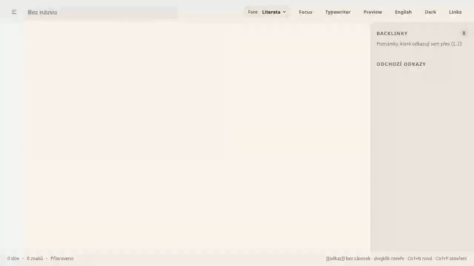
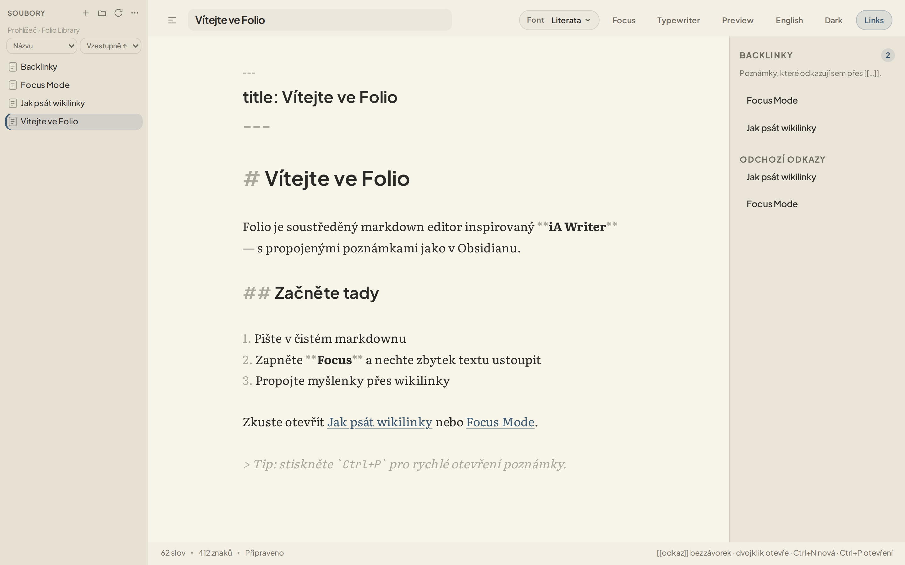
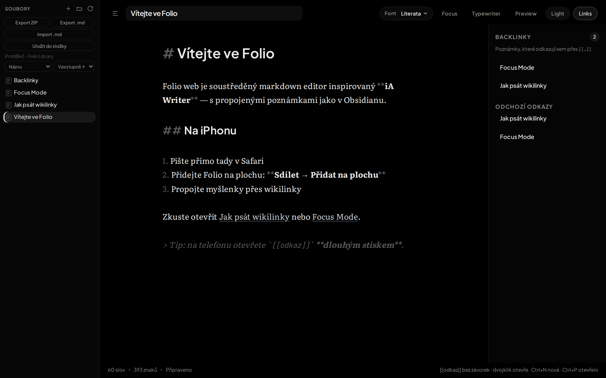
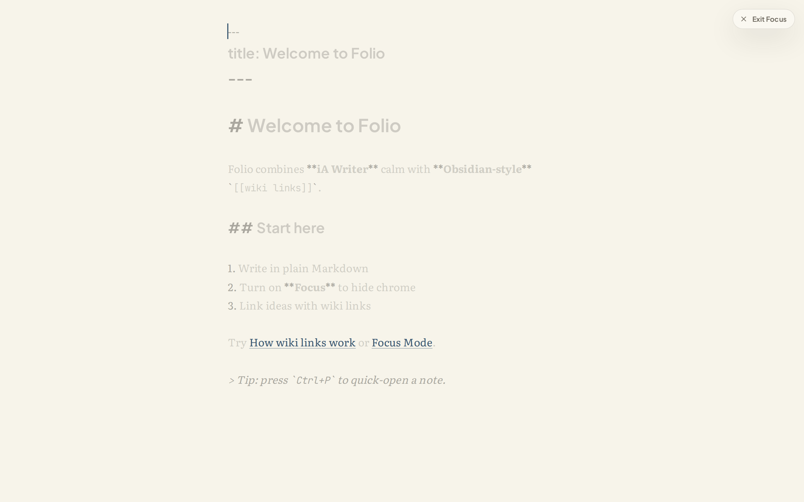
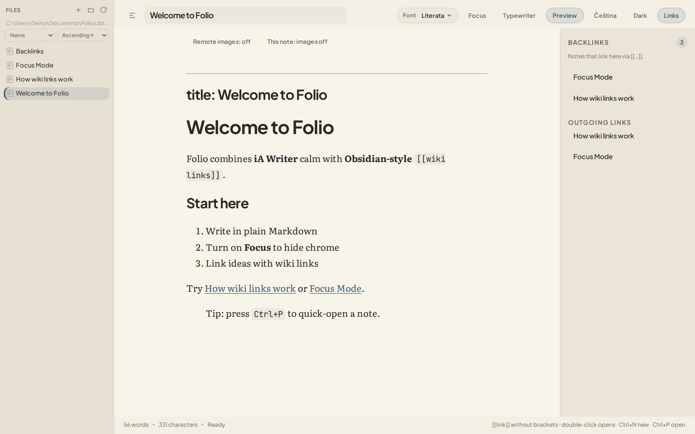

<div align="center">

# Folio

**A calm Markdown editor** — focused writing inspired by **iA Writer**, `[[wiki links]]` and a **backlinks** panel inspired by the linking idea in **Obsidian**.



[](https://github.com/samwe20/Folio/releases/download/folio-1.0.7/Folio_1.0.7_x64-setup.exe)
[](https://github.com/samwe20/Folio/actions/workflows/folio.yml)
[](LICENSE)
[](docs/development.md)

**[Windows installer (folio-1.0.7)](https://github.com/samwe20/Folio/releases/download/folio-1.0.7/Folio_1.0.7_x64-setup.exe)** · [All releases](https://github.com/samwe20/Folio/releases) · [Project site](https://samwe20.github.io/Folio/) · [Quick start](#quick-start)

</div>

## Latest release

| | |
|---|---|
| **Version** | [**Folio 1.0.7**](https://github.com/samwe20/Folio/releases/tag/folio-1.0.7) ([`folio-1.0.7`](https://github.com/samwe20/Folio/releases/tag/folio-1.0.7)) |
| **Installer** | [**Folio_1.0.7_x64-setup.exe**](https://github.com/samwe20/Folio/releases/download/folio-1.0.7/Folio_1.0.7_x64-setup.exe) (NSIS, ~3 MB) |
| **Platform** | Windows 10/11 (WebView2) |
| **User guide (CS + EN)** | [docs/release-latest.md](docs/release-latest.md) |

Published on GitHub Releases with tag **`folio-1.0.7`**.

**What's new in 1.0.7**

- **Toolbar menu (☰)** — version info, manual updates, export, preview image settings.
- **Drag-and-drop images** into notes (`assets/` folder on desktop).
- **English sample tutorial** on first run.

**Still core Folio:** Focus Mode, `[[wiki links]]`, backlinks, CS/EN UI, library on disk.

**Install in three steps:** download the `.exe` → run the installer → open Folio (default library: `Documents/Folio/Library`, or choose any folder of `.md` files).

Older releases: [GitHub Releases](https://github.com/samwe20/Folio/releases).

---

## Why Folio?

Folio is its own app. **iA Writer** and **Obsidian** are inspirations we credit—not products Folio tries to replace.

- **Writing feel** *(inspired by iA Writer)* — typography-first editing, Focus Mode, optional typewriter, and light/dark paper themes for calm drafting.
- **Backlinks** *(inspired by Obsidian)* — Folio takes the **idea of backlinks**: `[[wiki links]]`, autocomplete, and a panel of incoming/outgoing links. Not a plugin ecosystem or graph canvas.
- **Your folder, your sync** — the library is a **plain folder of `.md` files`**. Folio has **no built-in cloud sync**; store the library in **OneDrive**, **iCloud Drive**, or any synced folder and your files follow your usual sync.
- **Windows desktop** — Tauri 2 app with a local library on disk.
- **Bilingual app chrome** — toolbar **English / Čeština** for UI labels; your note text stays whatever language you write in.

---

## Screenshots

<table>
  <tr>
    <td width="50%">
      
      <br /><sub>Light theme · compact file tree</sub>
    </td>
    <td width="50%">
      
      <br /><sub>Dark theme · canvas #000000, sidebar #070707</sub>
    </td>
  </tr>
  <tr>
    <td>
      
      <br /><sub>Focus Mode · fullscreen, typewriter</sub>
    </td>
    <td>
      
      <br /><sub>Preview · sanitized HTML, wiki links</sub>
    </td>
  </tr>
</table>

---

## Download

| Platform | How |
|----------|-----|
| **Windows 10/11** | **Current:** [Folio 1.0.7 installer](https://github.com/samwe20/Folio/releases/download/folio-1.0.7/Folio_1.0.7_x64-setup.exe) · [release notes](docs/release-latest.md) · [all releases](https://github.com/samwe20/Folio/releases) |

---

## Quick start

```bash
git clone https://github.com/samwe20/Folio.git
cd Folio
npm ci
npm run desktop:dev    # Windows desktop
```

Details: [Windows](docs/windows.md)

**Experimental local web build** (not publicly hosted): `npm run web:dev` — see [docs/web-pwa.md](docs/web-pwa.md).

---

## Documentation

| Doc | Topics |
|-----|--------|
| [docs/release-latest.md](docs/release-latest.md) | **Current release** — install steps & what's new (CS + EN) |
| [docs/windows.md](docs/windows.md) | Install, development, shortcuts, library |
| [docs/web-pwa.md](docs/web-pwa.md) | Experimental local web build (developers) |
| [docs/ios-native.md](docs/ios-native.md) | Tauri iOS on Mac (developers) |
| [docs/development.md](docs/development.md) | Tests, CI, repo layout |
| [docs/reliability.md](docs/reliability.md) | Saving, undo, preview, limits |

---

## Contributing

Issues and pull requests are welcome. For larger changes, read [docs/development.md](docs/development.md) and run `npm test` + `npm run check`.

See [CONTRIBUTING.md](CONTRIBUTING.md).

---

## License

[MIT](LICENSE) — © [samwe20](https://github.com/samwe20).
