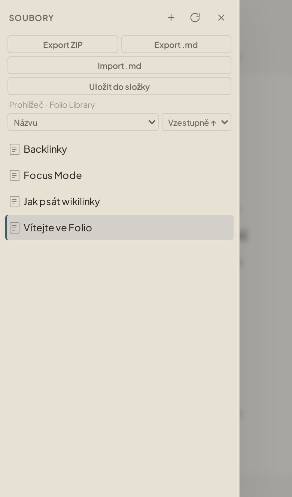

<div align="center">

# Folio

**Distraction-free Markdown writing** — iA Writer typography, Obsidian-style linked notes.

[](https://github.com/samwe20/Folio/releases/latest)
[](https://github.com/samwe20/Folio/actions/workflows/folio.yml)
[](LICENSE)
[](docs/development.md)

[Download for Windows](#download) · [Quick start](#quick-start) · [Docs](#documentation) · [Screenshots](#screenshots)

</div>

<video src="docs/assets/folio-demo.mp4" controls width="100%" muted loop playsinline>
  <a href="docs/assets/folio-demo.mp4">Download demo video</a>
</video>

---

## Screenshots

<table>
  <tr>
    <td width="50%">
      
      <br /><sub>Light theme · compact file tree</sub>
    </td>
    <td width="50%">
      
      <br /><sub>Dark theme · canvas #000000, sidebar #070707</sub>
    </td>
  </tr>
  <tr>
    <td>
      
      <br /><sub>Focus Mode · fullscreen, typewriter</sub>
    </td>
    <td>
      
      <br /><sub>Preview · sanitized HTML, wiki links</sub>
    </td>
  </tr>
  <tr>
    <td colspan="2" align="center">
      
      <br /><sub>PWA in Safari · mobile drawer (UI in Czech)</sub>
    </td>
  </tr>
</table>

---

## Why Folio

| | |
|---|---|
| ✍️ **Calm writing** | Typography-first editor, Focus Mode, optional typewriter |
| 🔗 **`[[Wiki links]]`** | Autocomplete, double-click (desktop), long-press (mobile) |
| ↩️ **Backlinks** | Live panel of incoming and outgoing links |
| 📁 **Your files** | Library = a folder of `.md` on disk (Windows); export/import on web |
| 🌓 **Light / dark** | Warm paper in light mode, near-black in dark mode |
| 🇨🇿 **Czech UI** | Labels and library sorting follow Czech locale rules |

Built with **Tauri 2** (Windows, NSIS + WebView2), **Vite + CodeMirror 6**, **DOMPurify** preview, offline **PWA** for iPhone.

---

## Download

| Platform | How |
|----------|-----|
| **Windows 10/11** | [Latest release](https://github.com/samwe20/Folio/releases/latest) → `Folio_*_x64-setup.exe` (standalone installer) |
| **iPhone (no Mac)** | Web / PWA — [guide](docs/web-pwa.md) |
| **Native iOS** | Mac + Xcode — [guide](docs/ios-native.md) |

---

## Quick start

```bash
git clone https://github.com/samwe20/Folio.git
cd Folio
npm ci
npm run desktop:dev    # Windows desktop
# npm run web:dev      # browser / PWA development
```

Details: [Windows](docs/windows.md) · [Web / PWA](docs/web-pwa.md)

---

## Documentation

| Doc | Topics |
|-----|--------|
| [docs/windows.md](docs/windows.md) | Install, development, shortcuts, library |
| [docs/web-pwa.md](docs/web-pwa.md) | iPhone, offline, export/import |
| [docs/ios-native.md](docs/ios-native.md) | Tauri iOS on Mac |
| [docs/development.md](docs/development.md) | Tests, CI, repo layout |
| [docs/reliability.md](docs/reliability.md) | Saving, undo, preview, limits |

---

## Contributing

Issues and pull requests are welcome. For larger changes, read [docs/development.md](docs/development.md) and run `npm test` + `npm run check`.

See [CONTRIBUTING.md](CONTRIBUTING.md).

---

## License

[MIT](LICENSE) — © 2026 [samwe20](https://github.com/samwe20).
